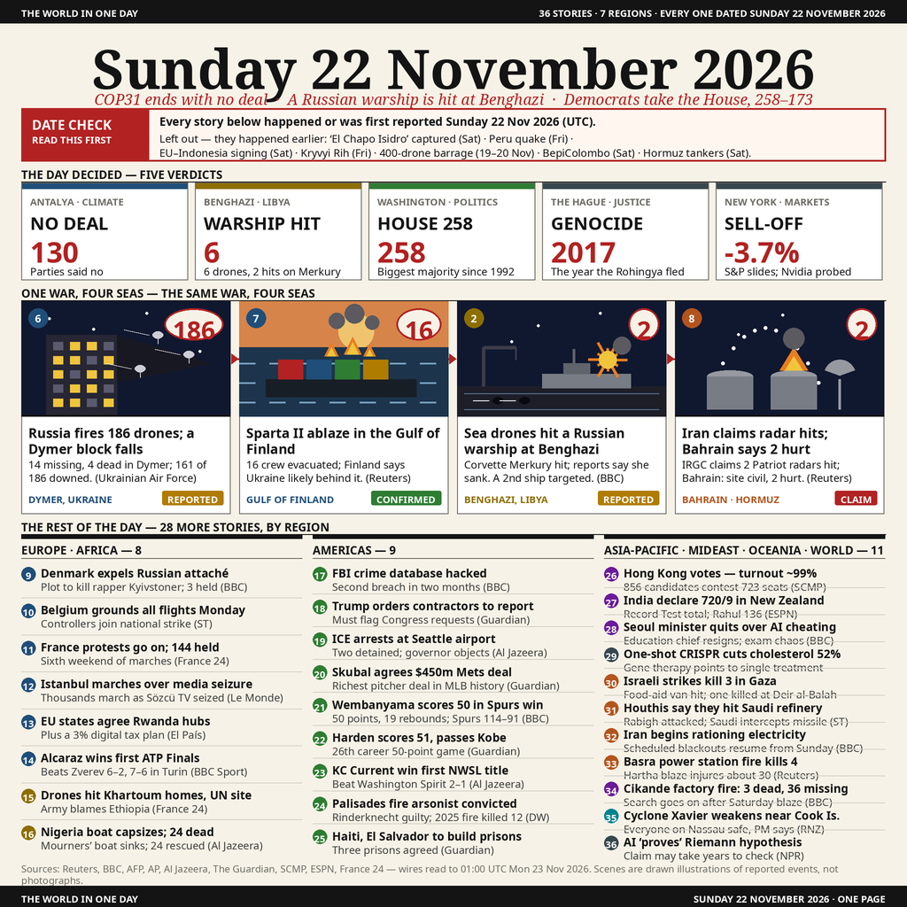

# Sunday 22 November 2026 — 36 dated stories, 7 regions

[](https://make.fun/bounty/news-image-20261122?utm_source=github&utm_medium=readme&utm_campaign=news-image-20261122)
[](https://make.fun/bounty/news-image-20261122/leaderboard?utm_source=github&utm_medium=readme&utm_campaign=news-image-20261122)
[](https://make.fun/bounty/news-image-20261122?utm_source=github&utm_medium=readme&utm_campaign=news-image-20261122)



One image that sums up the world's news of Sunday 22 November 2026:
**36 stories, 7 regions, 14 fields** — COP31 ends with no deal, a Russian
warship is hit at Benghazi, Democrats take the House 258–173.

## How it reads

- **DATE CHECK first.** A red proof strip sits directly under the masthead,
  before any story: every story below happened or was first reported on
  Sunday 22 Nov 2026 (UTC), and the well-known stories that belong to
  another day are named as left out ('El Chapo Isidro' captured Sat,
  Peru quake Fri, EU–Indonesia signing Sat, Kryvyi Rih Fri, the 400-drone
  barrage 19–20 Nov, BepiColombo Sat, Hormuz tankers Sat).
- **THE DAY DECIDED — five verdicts.** COP31 NO DEAL (130 parties said no),
  BENGHAZI WARSHIP HIT (6 drones), HOUSE 258, ICJ GENOCIDE (2017),
  SELL-OFF (−3.7%): the day's decisions, not just its events.
- **ONE WAR, FOUR SEAS.** Four scene panels joined by one drawn route line
  with arrows: Dymer (186 drones) → Sparta II ablaze (16 crew safe) →
  Benghazi (2 ships) → Bahrain/Hormuz (2 hurt). The same war running
  through four seas, each panel with one big number baked in.
- **THE REST OF THE DAY — 28 more stories in three region columns**
  (Europe · Africa / Americas / Asia-Pacific · Mideast · Oceania · World)
  in 12–13 px type — no tiny numbered list anywhere on the page, no
  footer mini-map with piled-up pins.

Every story happened, or was first reported, on Sunday 22 November 2026
(UTC), as the named outlets reported it. Claims are attributed; the IRGC
radar claim is labelled a claim, and Bahrain's denial is carried beside it.

## Reproduce

```sh
python3 render.py entry.png   # draws entry.png, 1024x1024, deterministic
python3 main.py               # copies entry.png to $MAKEFUN_OUTPUT_DIR
```

`render.py` draws everything procedurally with Pillow (Noto Serif / Noto
Sans, SIL OFL). No external assets, no network, no randomness: two runs
write byte-identical PNGs.

## License

MIT — see LICENSE.
